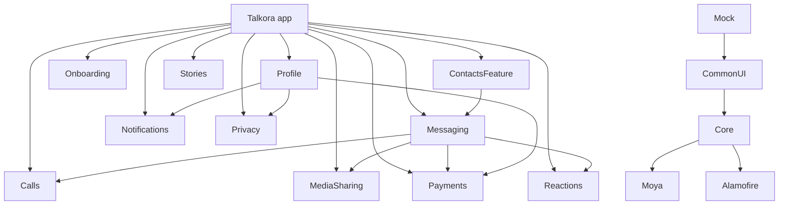

# Talkora

A SwiftUI messaging app for iOS 17+: chats, groups, channels, bots, calls, stories, payments. It runs against an
in-memory mock backend by default, so it works offline with no server.

MVVM with `@Observable` ViewModels, modular with [Tuist](https://tuist.io). For how the code is organised and why, read
[ARCHITECTURE.md](ARCHITECTURE.md).

## Requirements

- macOS with Xcode 16 or later (iOS 17 SDK)
- [Tuist](https://tuist.io) 4.x
- Swift packages (Moya, Alamofire) are fetched by Tuist

## Setup

### 1. Install Tuist

```bash
brew install --cask tuist       # or: brew install tuist
tuist version                   # 4.x
```

Prefer a pinned version per project? Install [mise](https://mise.jdx.dev) and run `mise use tuist@<version>`.

### 2. Fetch dependencies and generate the project

```bash
git clone <repo-url> && cd Talkora
tuist install                   # resolves Tuist/Package.swift (Moya, Alamofire)
tuist generate                  # creates Talkora.xcworkspace and opens it
```

`*.xcodeproj`, `*.xcworkspace` and `Derived/` are generated and git-ignored. Never edit them by hand.

### 3. Run

Open `Talkora.xcworkspace`, pick the **Talkora-Dev** scheme and an iPhone simulator, then press Run.

## Day-to-day

| When you... | Do this |
|---|---|
| add, move, rename or delete a Swift file | `tuist generate` (globs are resolved at generation time) |
| add a Swift package | edit `Tuist/Package.swift`, then `tuist install && tuist generate` |
| change `Project.swift` (modules, deps, settings) | `tuist generate` |
| get odd build errors after switching branches | `tuist clean && tuist install && tuist generate` |
| add a feature module | see [Adding a feature](#adding-a-feature) |
| change fixtures, DTOs or endpoints | regenerate `stubs.json` (see [ARCHITECTURE.md](ARCHITECTURE.md#backends)) |

## Environments

One scheme per environment, each mapped to a Debug and a Release configuration and an `Environment-*.xcconfig`
in `Talkora/Configuration`. Code can branch with `#if DEVELOPMENT`, `#if STAGING` or `#if PRODUCTION`.

| Scheme | Configurations |
|---|---|
| `Talkora-Dev` | `Debug-Development`, `Release-Development` |
| `Talkora-Staging` | `Debug-Staging`, `Release-Staging` |
| `Talkora-Prod` | `Debug-Production`, `Release-Production` |

## Backends

Choose with the launch argument `-talkora-backend <mock|stubbed|live>` (Xcode scheme > Arguments) or the
`TALKORA_BACKEND` environment variable.

| Backend | Use it for |
|---|---|
| `mock` (default) | Stateful in-memory server. Edits persist while the app runs |
| `stubbed` | Debug only. Real network stack answering from `Resources/Stubs/stubs.json`. Add `-talkora-stub-fail "GET /conversations=500"` to test error screens |
| `live` | Real API. Not usable yet (no sign-in or token storage) |

## Tests

```bash
xcodebuild test -workspace Talkora.xcworkspace -scheme Talkora-Dev \
  -destination 'platform=iOS Simulator,name=iPhone 17 Pro'
```

- `TalkoraTests`: unit tests, central for all modules (`@testable import <Module>`)
- `TalkoraUITests`: UI tests driven by launch arguments, for example `-talkora.session.currentUserId u1` skips onboarding

## Project layout

```
Talkora/            app target: App/ (entry, shell, tabs), Resources/, Configuration/
Targets/<Module>/Sources   one Tuist framework per module
TalkoraTests/       unit tests
TalkoraUITests/     UI tests
Tuist/Package.swift    external dependencies
Project.swift          modules, dependencies, schemes, build configurations
```

## Module graph

Every module depends on `Core` and `CommonUI`; those edges are left out below. Features may only depend on features
shown here, and the graph must stay acyclic. Features that open each other's screens live in one module
(that is why chats, groups, bots, channels and search are all in `Messaging`).



| Module | Role |
|---|---|
| `Core` | Models, repositories, networking, mock backend, navigation (`NavController`, `BaseDestination`), session |
| `CommonUI` | Design system and shared views |
| `Mock` | `PreviewData` for `#Preview`s and tests only |
| Feature modules | Screens, ViewModels and the destinations they own (`Targets/<Module>/Sources/Navigation`) |

## Navigation in one minute

Each module defines its own `Destination.X` next to its screen and overrides `getScreen`. To open another feature's
screen, import that module and call `navController.navigateTo(Destination.X())`; for a sheet use
`Destination.X().presentedScreen()`. Details in [ARCHITECTURE.md](ARCHITECTURE.md#crossing-feature-boundaries).

## Adding a feature

1. Create `Targets/<Name>/Sources` with `UI/Screens/<Screen>/` (`…Screen.swift` + `…ViewModel.swift`) and `Navigation/`.
2. Add it to `featureDependencies` in `Project.swift`, listing the features it opens (keep the graph acyclic).
3. Run `tuist generate`.

Avoid module names that match an Apple framework (a module named `Contacts` crashed the UI test runner, hence `ContactsFeature`).

## Troubleshooting

- **"No such module" after pulling:** `tuist install && tuist generate`.
- **Tuist reports a dependency cycle:** two features open each other. Merge them into one module.
- **New file not picked up:** run `tuist generate`.
- **Simulator name not found:** list devices with `xcrun simctl list devices available` and adjust `-destination`.

## Known gaps

See the end of [ARCHITECTURE.md](ARCHITECTURE.md).
